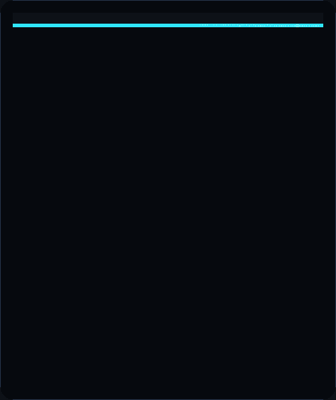
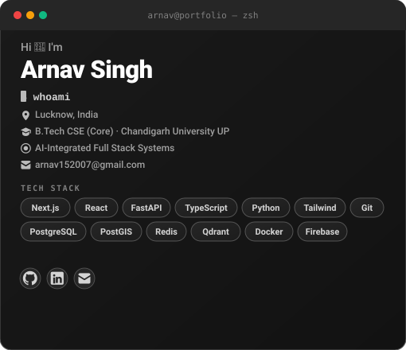
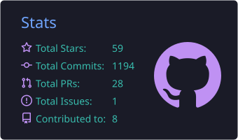
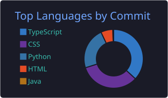
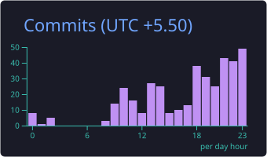

  
  &nbsp;&nbsp;
  

 

  
  &nbsp;
  
  &nbsp;
  
  &nbsp;
  
  &nbsp;
  

  <b>Computer Science Undergraduate · B.Tech CSE @ Chandigarh University</b> 
  Systems Architect · Distributed Platforms · Explainable AI · High-Resilience Backend Engines

### 📦 Published NPM Packages & Downloads

  
  &nbsp;&nbsp;
  

| Package | Description | Latest Version | Total Downloads |
| :--- | :--- | :---: | :---: |
| [**`arnav-audit`**](https://www.npmjs.com/package/arnav-audit) | Autonomous internal security, memory leakage & UI/UX auditor |  |  |
| [**`@arnavvv/deppulse`**](https://www.npmjs.com/package/@arnavvv/deppulse) | Universal dependency maintenance health & upgrade risk intelligence engine |  |  |
| [**`@arnavvv/traceguard`**](https://www.npmjs.com/package/@arnavvv/traceguard) | Deterministic API contract testing & breaking OpenAPI change detection engine |  |  |

---

### ⚡ Overview

I'm a Computer Science undergraduate (B.Tech CSE, Chandigarh University) focused on engineering high-throughput, AI-integrated systems with architectures that prioritize inspectability, correctness, and deterministic safety over opaque black-box outputs.

- **Backend & Systems:** Designing concurrent, low-latency architectures with **FastAPI (Python)** and **Next.js**, paired with **PostgreSQL**, **PostGIS**, and **Redis** for distributed geospatial routing, live caching, and sub-100ms event processing.
- **Applied AI & Explainability:** Architecting causal reasoning and retrieval-augmented generation (RAG) pipelines backed by **Tree-sitter AST parsing**, **pgvector/Qdrant** vector search, semantic embeddings, and deterministic risk AST evaluators where verified traceability takes precedence over hallucination.
- **Frontend & GIS:** Crafting ultra-responsive, mobile-first interfaces using **React 19**, **Next.js 14**, **Vite**, **Tailwind CSS**, and **Leaflet.js** with curated dark-mode design systems (Midnight Navy, Deep Slate, and Emerald tokens).

> **Current Focus:** Engineering high-resilience quantitative engines, clinical EEG biosignal telemetry, developer intelligence platforms, distributed real-time mesh networks, and deterministic geospatial routing systems targeting high-signal Software Engineering and Systems roles.

---

## 🛠️ Languages & Technologies

  <b>Languages & Core:</b> 
  
  
  
  
  
  
  

  <b>AI / Machine Learning / Vector Infrastructure:</b> 
  
  
  
  
  
  
  
  

  <b>Frameworks / Frontend / Real-time:</b> 
  
  
  
  
  
  

  <b>Databases & Infrastructure:</b> 
  
  
  
  

  <b>DevOps / Version Control / Deployment:</b> 
  
  
  

---

### 🧩 Core Competencies

<table width="100%">
  <tr>
    <td width="50%" valign="top">
      <h4>⚡ Full-Stack & Systems Engineering</h4>
      <ul>
        <li><b>Frontend Architectures:</b> React 19, Next.js 14 (App Router), Vite, Tailwind CSS, Leaflet.js, Three.js, Monaco Diff Viewer</li>
        <li><b>Backend Services:</b> FastAPI (Python 3.11+ async gateway), Next.js API Routes, Node.js CLI tooling</li>
        <li><b>Protocols & Event Buses:</b> WebSockets, Server-Sent Events (SSE), Redis Streams, Celery Distributed Task Queues</li>
        <li><b>Quantitative Engines:</b> Vectorized backtesting pipelines (NumPy / Pandas, 540k ticks/sec), async DMA execution</li>
      </ul>
    </td>
    <td width="50%" valign="top">
      <h4>🤖 Applied AI & Deep Learning Systems</h4>
      <ul>
        <li><b>Causal Reasoning & ASTs:</b> Tree-sitter AST structural chunking, semantic git diff causality, calibrated confidence scoring</li>
        <li><b>Vector Search & RAG:</b> PostgreSQL + pgvector (HNSW cosine indexing), Qdrant vector engine, dense semantic embeddings</li>
        <li><b>Model Orchestration:</b> Claude 3.5 Sonnet & Claude 3.5 Haiku, OpenAI (GPT-4o & GPT-4o mini, embeddings), structured tool calling, deterministic verification</li>
        <li><b>Deep Learning & Biosignals:</b> PyTorch & TensorFlow models, EEG signal processing (SciPy, ssqueezepy continuous wavelets)</li>
      </ul>
    </td>
  </tr>
  <tr>
    <td width="50%" valign="top">
      <h4>🗺️ Geospatial Telemetry & Real-Time Routing</h4>
      <ul>
        <li><b>Spatial & Stream DBs:</b> PostgreSQL 16, PostGIS, TimescaleDB, Redis Streams for sub-100ms event delivery</li>
        <li><b>GIS & Path Optimization:</b> Shapely, Overpass OSM API, dynamic bypass polyline calculation, Leaflet.js offline GIS</li>
        <li><b>Environmental Fusion:</b> Live IMD meteorological telemetry, contour slope radars, multi-zone risk classification</li>
        <li><b>Physiological Risk:</b> Acute Mountain Sickness (AMS) altitude hypoxia curve modeling</li>
      </ul>
    </td>
    <td width="50%" valign="top">
      <h4>⚙️ Infrastructure, Security & Reliability</h4>
      <ul>
        <li><b>Containers & Microservices:</b> Docker, Docker Compose multi-container networks, isolated worker & Redis services</li>
        <li><b>CI/CD & Edge Deployment:</b> GitHub Actions automated test & lint pipelines, Vercel production edge</li>
        <li><b>Static Security Auditing:</b> Custom AST CLI auditor (MEJOR) for secret gateway leaks and memory profiling</li>
        <li><b>Security & Auth:</b> AES-256 Demat envelope encryption, OAuth 2.0, Firebase Admin SDK, JWT, pytest test suites</li>
      </ul>
    </td>
  </tr>
</table>

---

### 🚀 Featured Engineering Systems

#### **1. CLUDE — Autonomous Production Incident Root-Cause Engine & Codebase Intelligence**
> Pinpoints the exact commit that broke production with causal AI reasoning and onboards engineers to unfamiliar codebases in minutes. Evaluates semantic causality across structural git diffs to correlate multiline stack traces (Python, Node.js/TS, Go, Java, Rust) against commit history in < 8s. Features Tree-sitter syntax-aware AST chunking, PostgreSQL 16 with `pgvector` HNSW acceleration, Claude 3.5 Sonnet & Haiku / GPT-4o & GPT-4o mini causal reasoning chains with calibrated confidence scoring, embedded Monaco-style syntax diff viewer, high-risk churn danger-zone detection, interactive GitHub account connection with granular repository permissions, and repo-grounded dark-mode Mermaid.js architectural topology graphs.

  
  
  
  
  
  
  
  

[→ Live Demo](https://frontend-mu-roan-llgeruknl5.vercel.app) &nbsp;|&nbsp; [→ Source Code](https://github.com/arnnnnaaavvvvv/CLUDE) &nbsp;|&nbsp; [→ Architecture Spec](https://github.com/arnnnnaaavvvvv/CLUDE/blob/main/ARCHITECTURE.md)

---

#### **2. IGNITE — Dynamic Tourist Safety & Smart Route Engine**
> Pan-India tourist safety routing and itinerary engine covering all **28 States & 8 Union Territories**. Fuses live IMD meteorological data, 6 environmental natural zones, Acute Mountain Sickness (AMS) hypoxia altitude risk scoring, date-aware regional crowd curves, and autonomous hazard rerouting into an explainable, deterministic risk-scored engine. Features offline-first Leaflet GIS maps, real-time WebSocket emergency mesh telemetry, red/yellow/green semantic risk hierarchy, single-accent Midnight Navy & Emerald UI, dual-language engine (EN/HI) with toggle-driven display, and multi-agency emergency rescue dispatch (SDRF/NDRF/ITBP).

  
  
  
  
  
  
  
  

[→ Live Production Demo](https://ignite-lemon-nu.vercel.app/) &nbsp;|&nbsp; [→ Source Code](https://github.com/arnnnnaaavvvvv/IGNITE) &nbsp;|&nbsp; [→ Architecture Spec](https://github.com/arnnnnaaavvvvv/IGNITE/blob/main/ARCHITECTURE.md)

---

#### **3. NeuroSense — Clinical EEG & Polysomnography Telemetry Intelligence**
> Clinical-grade electroencephalography (EEG) and polysomnography (PSG) telemetry intelligence platform bridging automated microvolt signal processing, deep spatial-frequency representation learning, and deterministic clinical decision support. Detects pre-onset risk trajectories (60–90s lookback windows prior to acute obstructive sleep apnea or panic onset), quantifies multi-window cortical arousal velocity ($\Delta\text{Beta}\%$) and acceleration ($\Delta^2$), and renders real-time 128 Hz calibrated microvolt waveforms ($\pm 60\,\mu\text{V}$) across standard 10–20 derivations (Fp1, F3, Fz, F4, Cz, Pz, O1). Features 128×128 STFT spectrogram matrices, quantitative cranial EMG/EOG artifact screening, dual-head multi-task CNN (Özdemir Conv2D backbone) with Leave-One-Subject-Out Cross-Validation (93.8% accuracy), and zero-hallucination clinical guideline RAG grounded in AASM, NICE, and APA standards.

  
  
  
  
  
  
  
  

[→ Live Production Demo](https://neurosense-orcin.vercel.app) &nbsp;|&nbsp; [→ Source Code](https://github.com/arnnnnaaavvvvv/NeuroSense) &nbsp;|&nbsp; [→ Architecture Spec](https://github.com/arnnnnaaavvvvv/NeuroSense/blob/main/ARCHITECTURE.md)

---

#### **4. SIRUS — Enterprise Multi-Tenant Quantitative Engine & Algorithmic Trading Platform**
> High-throughput systematic algorithmic trading SaaS with Direct Market Access (Zerodha Kite, Alpaca, KuCoin, Interactive Brokers, AngelOne, Upstox, Groww). Features sub-100ms vectorized NumPy/Pandas strategy backtesting processing **540,000 ticks/sec**, an AES-256 envelope-encrypted Demat key vault, interactive real-time parameter simulator, Redis Streams event bus, and a Paddle Billing inspired sleek dark interface with Three.js wave particle visuals.

  
  
  
  
  
  
  

[→ Live Production Demo](https://web-frontend-three-gamma.vercel.app/) &nbsp;|&nbsp; [→ Source Code](https://github.com/arnnnnaaavvvvv/SIRUS) &nbsp;|&nbsp; [→ Architecture Spec](https://github.com/arnnnnaaavvvvv/SIRUS/blob/main/ARCHITECTURE.md)

---

## 📊 GitHub Contribution & Activity

  

    
  

  

    
    &nbsp;
    
  

  
  

    
    &nbsp;
    
  

---

## 🔭 Currently Exploring & Engineering

- **Low-Latency Distributed Systems:** Benchmarking zero-allocation serialization protocols and concurrent actor models.
- **Geospatial Indexing at Scale:** High-resolution spatial partitioning using Uber H3 hexagonal hierarchical spatial indexes.
- **Deterministic Explainability in AI:** Combining probabilistic LLM tool outputs with formal rule-based verification ASTs.

---

## 🤝 Connect With Me

  
  &nbsp;&nbsp;
  
  &nbsp;&nbsp;
  
  &nbsp;&nbsp;
  

---

  Engineered with precision by <b>Arnav Singh</b> · B.Tech CSE @ Chandigarh University · Built for High-Resilience Production

